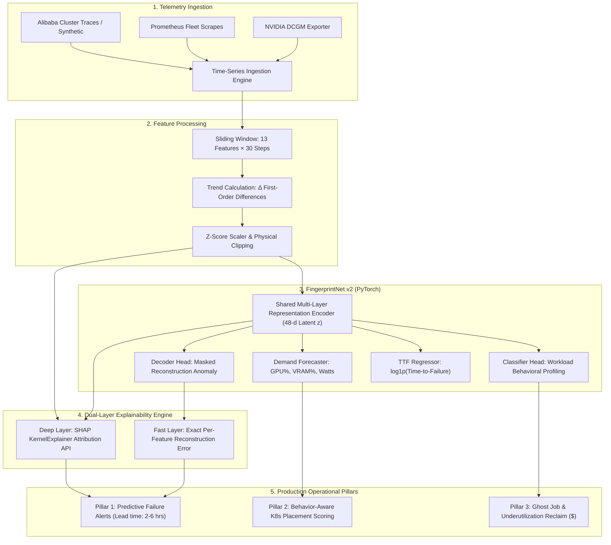

# 💓 Cluster Heartbeat v2 — Explainable AI Telemetry & Predictive Operations for GPU Clusters

<div align="center">


[](https://python.org)
[](https://pytorch.org)
[](https://shap.readthedocs.io)
[](https://fastapi.tiangolo.com)
[](https://prometheus.io)
[](dashboards/grafana_dashboard.json)
[](docker-compose.yml)

<br/>

**The second-generation AI GPU fleet intelligence system featuring Dual-Layer Explainability (Reconstruction Attribution + Model-Agnostic SHAP), Pre-trained Checkpoints, and Multi-Head Neural Fingerprinting.**  
*Predicts hardware failures hours in advance, drives intelligent Kubernetes GPU scheduling, and eliminates idle cloud GPU spend.*

[🚀 Quickstart](#-quickstart) • [🧠 Dual-Layer Explainability (SHAP)](#-dual-layer-explainability) • [🏛️ Architecture](#️-architecture--neural-pipeline) • [📊 The 13 Features](#-the-13-telemetry-features) • [📈 Dashboards & API](#-dashboards--rest-api)

---

</div>

## 📌 What's New in v2?

Cluster Heartbeat v2 builds upon the core multi-task autoencoder engine with significant production and explainability enhancements:

- 🔍 **Dual-Layer Explainability:** In addition to instant mathematical reconstruction attribution, v2 adds an on-demand, model-agnostic **SHAP (KernelExplainer)** attribution endpoint (`/api/v1/nodes/{id}/shap_explain`).
- 🎯 **Pre-Trained Checkpoints Included:** Ships with calibrated weights (`checkpoints/best`) and pre-computed normalization parameters for immediate zero-shot evaluation.
- ⚡ **Enhanced Anomaly Calibration:** Fleet-wide z-score normalization with physical guardrails and trend ($\Delta$) channel ingestion.
- 📊 **Comprehensive Ablation Reports:** Documented ablation benchmarks across model depths, latent dimensions, and baseline PCA / Isolation Forest comparisons.

---

## 🏛️ Architecture & Neural Pipeline



---

## 🔍 Dual-Layer Explainability (XAI)

In mission-critical data centers, system administrators will not act on opaque "black box" anomaly scores. Cluster Heartbeat v2 implements **two complementary layers of transparent explanation**:

```
                                  ┌── Layer 1: Instant Exact Attribution (Zero latency, model reconstruction error)
Unified Workload Fingerprint ─────┤
                                  └── Layer 2: Model-Agnostic SHAP KernelExplainer (Black-box perturbation verification)
```

1. **Layer 1: Exact Reconstruction Attribution (Fast / Streaming):**
   - Computed instantaneously during inference without approximation.
   - Decomposes the anomaly score into individual feature deviations: `anomaly_features`, `observed_vs_expected`, and human-readable reason codes.
2. **Layer 2: Model-Agnostic SHAP Explainer (On-Demand Deep Audit):**
   - Accessible via `GET /api/v1/nodes/{node_id}/shap_explain`.
   - Treats the model as a black box and runs game-theoretic Shapley value perturbations against background node windows to prove why a node received its failure risk score.

---

## 📊 The 13 Telemetry Features

| Index | Metric | Source | Unit | Operational Significance |
|:---:|:---|:---|:---:|:---|
| `00` | `gpu_utilization` | NVIDIA DCGM | % | Active compute kernel execution time |
| `01` | `gpu_memory_util` | NVIDIA DCGM | % | VRAM capacity allocated and held |
| `02` | `gpu_temperature` | NVIDIA DCGM | °C | Thermal junction temperature |
| `03` | `power_usage` | NVIDIA DCGM | Watts | Real-time board power draw |
| `04` | `ecc_errors` | NVIDIA DCGM | count | Single-bit & double-bit memory errors |
| `05` | `xid_errors` | DCGM / Syslog | code | NVIDIA driver critical event interrupts |
| `06` | `cpu_usage` | Node Exporter | % | Host CPU utilization |
| `07` | `ram_usage` | Node Exporter | % | Host RAM footprint |
| `08` | `net_throughput` | Node Exporter | MB/s | Inter-node NCCL communication & dataset streaming |
| `09` | `disk_io` | Node Exporter | MB/s | Checkpoint write throughput & dataset caching |
| `10` | `job_runtime` | Slurm / Kube | hours | Total runtime of current active job |
| `11` | `queue_length` | Scheduler | count | Jobs pending allocation |
| `12` | `active_processes` | Procfs | count | Active GPU context process count |

---

## 📁 Repository Structure

```plaintext
cluster-heartbeat-v2/
├── checkpoints/              # Pre-trained models & scaler weights
│   └── best/                 # Production-calibrated FingerprintNet checkpoint
├── configs/                  # Hyperparameter YAML definitions
│   ├── default.yaml          # Master configuration
│   └── features.yaml         # Telemetry feature schema
├── dashboards/               # Grafana dashboard definitions
├── deploy/                   # Prometheus & Grafana service configurations
├── reports/                  # Pre-computed ablation reports & sample outputs
├── scripts/                  # Generation, training, evaluation, and serving scripts
├── src/cluster_heartbeat/    # Core Python engine
│   ├── api/                  # FastAPI web server, OpenAPI models, SHAP endpoints
│   ├── data/                 # Ingestion, physical clipping, sliding windows
│   ├── inference/            # Streaming scoring, dual-layer attribution
│   ├── models/               # PyTorch FingerprintNet & PCA implementations
│   ├── services/             # Three operational pillars
│   └── training/             # Loss formulation, masking, validation
├── static/                   # Embedded web UI & visual dashboard assets
├── tests/                    # Pytest test suite (shapes, scoring, SHAP)
├── docker-compose.yml        # Full-stack Docker deployment
├── Dockerfile                # Production container spec
└── requirements.txt          # Python dependencies
```

---

## ⚡ Quickstart

### 1. Installation
```bash
git clone https://github.com/nahidzaman1996271-sketch/cluster-heartbeat-v2.git
cd cluster-heartbeat-v2

python -m venv venv
# Windows:
.\venv\Scripts\activate
# Linux/macOS:
source venv/bin/activate

pip install -r requirements.txt
pip install -e .
pip install shap  # Optional: enables Layer-2 SHAP explainability endpoint
```

### 2. Run Inference with Pre-Trained Weights
```bash
python scripts/run_inference.py --checkpoint checkpoints/best --input data/synthetic
```

### 3. Launch FastAPI Server
```bash
python scripts/serve.py --host 0.0.0.0 --port 8000
```
Interactive documentation is available at `http://localhost:8000/docs`.

### 4. Query SHAP Explainability Endpoint
```bash
curl -X GET "http://localhost:8000/api/v1/nodes/node_03/shap_explain?background_samples=20"
```

---

## 🐳 Docker Deployment

```bash
# Launch the full stack (API + Prometheus + Grafana):
docker compose up -d
```
- **REST API & Swagger:** `http://localhost:8000/docs`
- **Fleet Grafana Dashboard:** `http://localhost:3000` (`admin` / `admin`)
- **Prometheus Telemetry Scraper:** `http://localhost:9090`

---

## 👥 Hackathon Team & Acknowledgments

- **Hackathon:** AI for Cluster Intelligence Hackathon
- **Team:** Team Slow Walker
- **Team Leader:** Nahid Ibn Zaman
- **Project Mentor:** Md Adib Hossain

---

<div align="center">
  <sub>Engineered by <a href="https://github.com/nahidzaman1996271-sketch">Nahid Zaman</a> and Team Slow Walker</sub>
</div>
